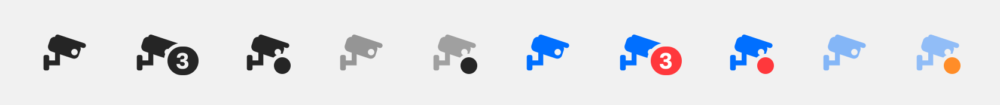

# Protect Cameras

Your UniFi Protect cameras and events in the macOS menu bar: a snapshot grid of every camera, a near-live view of any one of them, a log of detections and doorbell rings, and macOS notifications with the snapshot attached.




## Install

Requires macOS 14+, the Xcode Command Line Tools (`xcode-select --install`), and UniFi Protect 5.3 or later (for the Integration API).

```sh
make install      # builds "Protect Cameras.app", copies it to ~/Applications, launches it
```

`make app` builds into `build/` without installing. Opening the app again (Spotlight, Finder) brings up Settings, which helps when a menu bar manager has hidden the item.

## Setting it up

1. In Protect, go to **Settings → Control Plane → Integrations** and create an API key.
2. In the app's **Settings → Console**, enter the console's address and paste the key. Click **Connect**.
3. If the console uses its built-in self-signed certificate (or you entered an IP address), the app shows the certificate's SHA-256 fingerprint. Compare it with what your browser shows for the console, then click **Trust This Certificate**. From then on the app accepts exactly that certificate. A certificate macOS already trusts, such as Let's Encrypt on a hostname, needs no confirmation and can renew freely.
4. Allow notifications when macOS asks, and allow local network access if prompted.

The key is stored in the login Keychain. The app only reads from Protect: it never changes camera settings, arms the alarm, or talks back through a doorbell.

## Using it

- **Click** the icon for the popover.
  - **Cameras**: a snapshot of every camera, refreshed every few seconds while the popover is open (nothing is fetched while it's closed). A red outline and icon mark a camera with a detection in progress.
  - **Click a camera** for a large view that refreshes about once a second in high quality, its recent events, and a button to mute that camera's notifications.
  - **Events**: detections, doorbell rings and alarm sounds, each with the snapshot taken when it happened. Click one to jump to its camera.
- The **badge** counts new events you'd be notified about since you last opened the popover. The icon dims while the app isn't receiving events, and an orange dot means an error (the popover explains it).
- **Right-click** the icon for Refresh, Open Protect in Browser, Pause Notifications (30 minutes to tomorrow morning), Settings and Quit.

## Notifications

Settings → Notifications picks what's worth a banner:

- **Kinds**: doorbell rings, people, vehicles, packages and alarm sounds (smoke, CO, glass break, siren…) and sensors are on by default. Animals, license plates, faces and plain motion are off.
- **Cameras**: turn individual cameras off, or use the mute button in a camera's view.
- **Don't repeat** for the same camera and kind within a minute (adjustable), so one person walking around the yard is one banner. Doorbell rings always come through after 10 seconds.
- **Clicking a banner** shows that camera in the popover, or opens Protect in the browser.
- **Send Test Notification** posts a sample with a live snapshot.

## Limitations

- **No history from before the app started.** Protect's Integration API pushes events as they happen but has no way to list past ones. The event log (kept for 7 days in `~/Library/Application Support/ProtectCameras/`) only covers time the app was running and connected. If your laptop is asleep or off your network, those events are only in Protect.
- **"Live" means about one frame per second.** The view is built from snapshots. Real video would need an RTSP player, which macOS doesn't include. Use **Open in Protect** for full video and playback.
- **Thumbnails are snapshots taken when the event arrives**, not Protect's own event thumbnails (the Integration API doesn't offer those), so they can be a moment late.

## Terminal

```sh
ProtectCameras --print                    # console, cameras, recent events from the app's log
ProtectCameras --watch                    # stream raw websocket events (Ctrl-C to stop)
ProtectCameras --snapshot "Front Yard" yard.jpg
```

They use the app's saved console and key (or `PROTECT_CAMERAS_HOST` / `PROTECT_CAMERAS_API_KEY`) and never write the app's event log, so they're safe to run while it's open. `make print` and `make watch` run them through `swift run`.

## Development

```sh
swift build
swift run ProtectCameras --render-previews docs   # regenerate the images above
PROTECT_CAMERAS_DEBUG=1 "build/Protect Cameras.app/Contents/MacOS/ProtectCameras"   # log requests and events
```

| File | What's in it |
| --- | --- |
| `ProtectAPI.swift` | Integration API calls, certificate pinning, the reconnecting websocket |
| `ProtectStore.swift` | Camera list, snapshot feeds, event log, notification rules |
| `Models.swift` | Cameras, events, event kinds and their wording, errors |
| `SystemNotifier.swift` | macOS notifications with snapshot attachments |
| `Logo.swift` | Camera glyph, menu bar renderer, app icon |
| `StatusItemController.swift`, `PopoverView.swift`, `SettingsView.swift` | UI |

## License

[MIT](LICENSE). UniFi and UniFi Protect are trademarks of Ubiquiti Inc. This project isn't affiliated with Ubiquiti.
